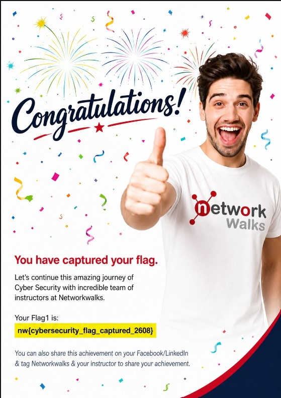

# NETWORKWALKS B084 – WEEK 3: PASSWORD CRACKING

## 📌 Overview

Welcome to my Week 3 Cybersecurity Practical Projects repository, completed as part of the **NetworkWalks Cybersecurity and Penetration Testing Training (Batch B084).**

This repository documents two practical sessions focused on password security, password-cracking concepts, PDF hash extraction, and the application of cybersecurity tools in authorised laboratory environments.

### Projects Covered

- **W3-PM1:** Password Cracking with John the Ripper (JTR).
- **W3-PM2:** Password Cracking with NW Tools.

---

# 🎯 PROJECT 1: W3-PM1 – PASSWORD CRACKING WITH JOHN THE RIPPER (JTR)

## 📖 Overview

This practical session focuses on understanding John the Ripper (JTR), its functionality, and its application in password security assessment.

The exercise provides practical exposure to password auditing concepts, PDF hash extraction, and the importance of identifying weak password practices.

## 🛠️ Tools Used

- John the Ripper (JTR)
- OnlineHashCrack PDF Hash Extractor

## 🔗 PDF Hash Extraction Tool

The following online tool was used to extract the PDF hash required for the JTR practical exercise.

**Tool:** [OnlineHashCrack – PDF Hash Extractor](https://www.onlinehashcrack.com/tools-pdf-hash-extractor.php)

**Purpose:** Extracting PDF password hashes for authorised password security testing and laboratory exercises.

## 📸 Practical Evidence

The following screenshots document my practical activities during the John the Ripper session.

### Screenshot 1 – JTR Practical Exercise

### Screenshot 2 – JTR Practical Exercise

### Screenshot 3 – JTR Practical Exercise

## 📚 Learning Outcomes

- Understanding John the Ripper.
- Introduction to password auditing.
- Understanding PDF hash extraction.
- Exploring password security weaknesses.
- Learning the importance of strong passwords.
- Applying cybersecurity tools in an authorised laboratory environment.

---

# 🎯 PROJECT 2: W3-PM2 – PASSWORD CRACKING WITH NW TOOLS

## 📖 Overview

This practical session explores password-cracking concepts using NW Tools as introduced during the NetworkWalks training.

The exercise provides an opportunity to understand the tools, their applications, PDF hash extraction, and their relevance to password security assessment.

## 🛠️ Tools Used

- NW Tools
- NetworkWalks Hash Calculator

## 🔗 PDF Hash Extraction Tool

The following tool was used to generate or extract the PDF hash for the NW Tools practical exercise.

**Tool:** [NetworkWalks – Hash Calculator](https://networkwalks.com/hash-calculator/)

**Purpose:** Generating and extracting hashes for the practical exercise.

## 📸 Practical Evidence

### Screenshot 1 – NW Tools Practical Exercise

## 📚 Learning Outcomes

- Understanding NW Tools.
- Exploring PDF hash extraction.
- Understanding password security assessment.
- Developing practical cybersecurity skills.
- Understanding responsible password auditing.

---

## 🧰 Tools & Technologies

| Tool | Application |
|---|---|
| John the Ripper (JTR) | Password security auditing |
| NW Tools | Practical password security exercise |
| OnlineHashCrack | PDF hash extraction for JTR |
| NetworkWalks Hash Calculator | PDF hash extraction for NW Tools |
| GitHub | Project documentation and version control |

## 🛡️ Ethical Considerations

All activities documented in this repository are intended strictly for educational purposes and authorised cybersecurity laboratory environments.

Password security assessments should only be conducted on systems, accounts, and password samples for which explicit permission has been granted.

No unauthorised access to personal accounts or third-party systems is intended.

## 👨‍💻 Author

**AKANBI TEMITOPE BENJAMEN**

Cybersecurity Student | Aspiring Cyber Analyst | Digital Forensics Enthusiast

**Training:** NetworkWalks – Batch B084

## 🙏 Acknowledgement

Special appreciation to NetworkWalks, the instructors, facilitators, and everyone contributing to my cybersecurity learning journey.

Thank you for providing an opportunity to learn, practise, and develop practical skills in cybersecurity.

---

⭐ **Thank you for visiting my repository!**

**LEARNING | PRACTISING | BUILDING | GROWING IN CYBERSECURITY**
